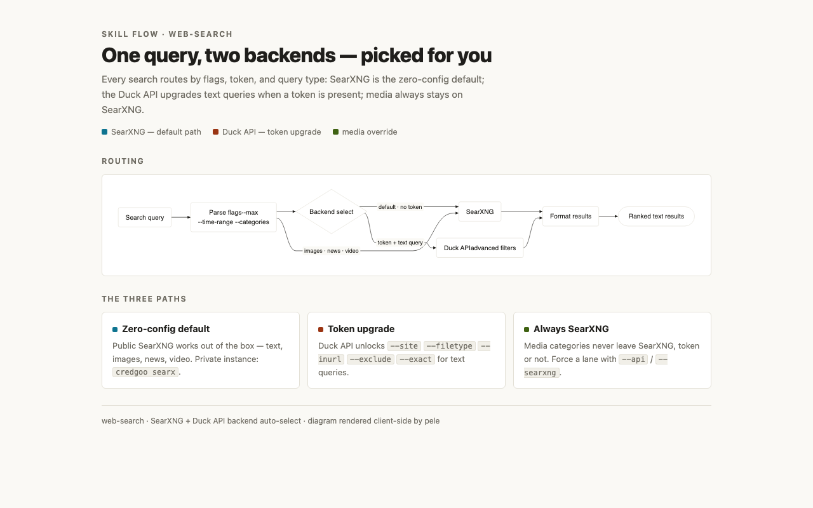
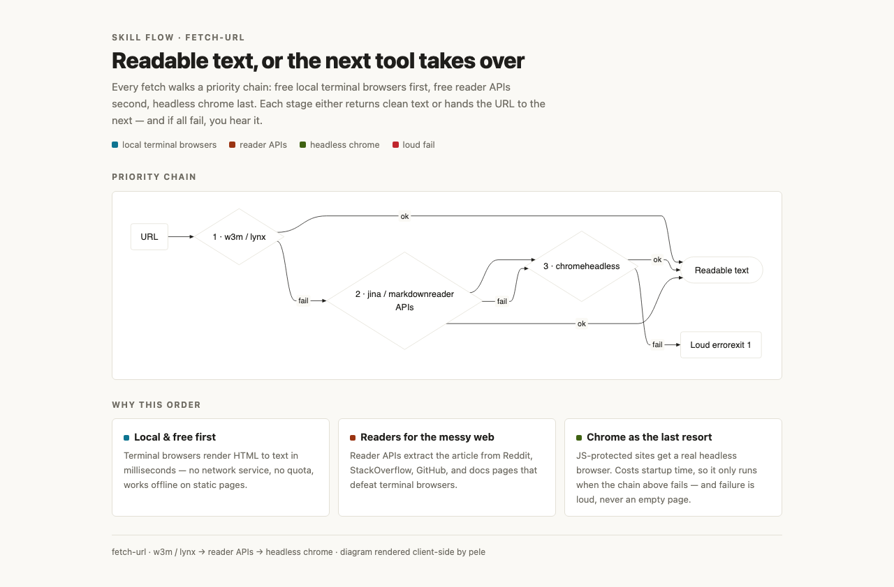
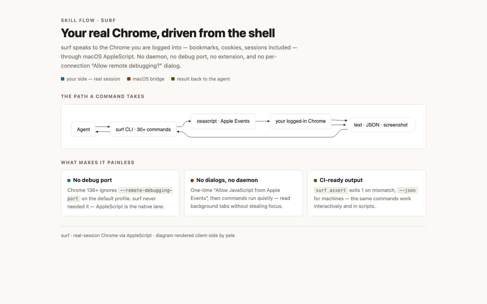
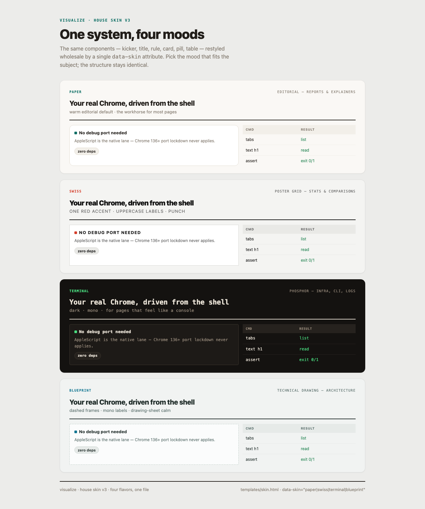
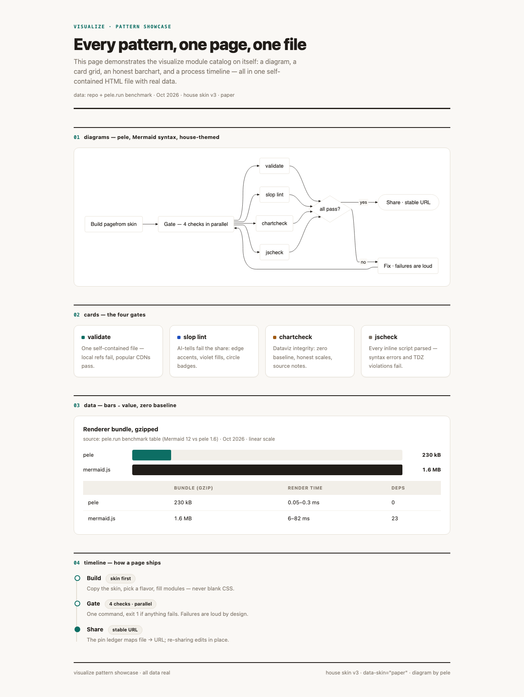

# Skill Diagrams

High-level flow diagrams for the core skills. Each ships a **visualize page** (HTML source
of truth, house skin v3 — pele-rendered diagrams) and a derived **PNG** for embedding.
Re-render after editing: open the HTML in headless Chrome and screenshot at page height
(rodney: `screenshot -w 1280 -h <scrollHeight>`).

```bash
# pele diagrams render client-side — open the file, wait, then screenshot
rodney start && rodney open "file://$PWD/docs/diagrams/web-search-flow.html" && sleep 3
rodney screenshot -w 1280 -h 800 docs/diagrams/web-search-flow.png && rodney stop
```

> Legacy D2 renders still live in [`diagrams/`](diagrams/) (`.d2` sources + `.svg`);
> legacy hand-drawn figures in [`images/`](images/). See each section below.

---

## web-search



`web-search` **routes to one of two backends**: **SearXNG** by default (public, zero-config,
or private via `credgoo searx`) — the happy path for text, images, news, and videos; or the
**Duck API** upgrade when a token is present (carries the advanced filters:
`--site`/`--filetype`/`--inurl`/`--exclude`/`--exact`). Media queries always route to
SearXNG even with a token; `--api`/`--searxng` force a backend.

> visualize page (house skin v3, paper flavor, pele diagram) — source
> [`diagrams/web-search-flow.html`](diagrams/web-search-flow.html), PNG derived.
> Legacy: hand-drawn figure [`images/web-search.png`](images/web-search.png) · D2 view
> [`diagrams/web-search.svg`](diagrams/web-search.svg) (source
> [`diagrams/web-search.d2`](diagrams/web-search.d2)).

Skill: [`skills/web-search`](../skills/web-search)

---

## fetch-url



`fetch-url` **auto-selects the best tool** and falls back gracefully through a **priority
chain**: free local **terminal browsers** (`w3m` / `lynx`) → free **reader APIs** (`jina` /
`markdown`) → **chrome** (headless, for JS-protected sites). On failure it drops to the next
tool; on success it extracts and returns clean text — and if all fail, it fails loud.

> visualize page (house skin v3, paper flavor, pele diagram) — source
> [`diagrams/fetch-url-flow.html`](diagrams/fetch-url-flow.html), PNG derived.
> Legacy: hand-drawn figure [`images/fetch-url.png`](images/fetch-url.png) · D2 view
> [`diagrams/fetch-url.svg`](diagrams/fetch-url.svg) (source
> [`diagrams/fetch-url.d2`](diagrams/fetch-url.d2)).

Skill: [`skills/fetch-url`](../skills/fetch-url)

---

## surf



`surf` drives your **real, logged-in Chrome** through macOS AppleScript — **no debug port, no extension, no per-connection "Allow remote debugging?" dialog**, zero dependencies. Commands map to AppleScript `execute javascript` / tab control.

> visualize page (house skin v3, paper flavor, pele diagram) — source
> [`diagrams/surf-flow.html`](diagrams/surf-flow.html), PNG derived.
> Legacy D2 view: [`diagrams/surf-flow.svg`](diagrams/surf-flow.svg) (source
> [`diagrams/surf-flow.d2`](diagrams/surf-flow.d2)).

Skill: [`skills/surf`](../skills/surf) · Guide: [`browser-use/surf.md`](browser-use/surf.md)

---

## visualize — self-demos



**One system, four moods**: the same components restyled wholesale by a single
`data-skin` attribute. Source: [`diagrams/visualize-flavors.html`](diagrams/visualize-flavors.html).



**Every pattern on one page**: pele diagram, card grid, honest barchart, process timeline —
all real data. Source: [`diagrams/visualize-showcase.html`](diagrams/visualize-showcase.html).
Flow of the skill itself: [`diagrams/visualize-flow.html`](diagrams/visualize-flow.html).

Skill: [`skills/visualize`](../skills/visualize)
